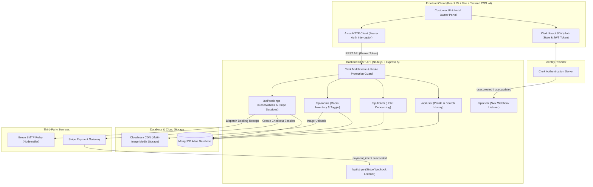
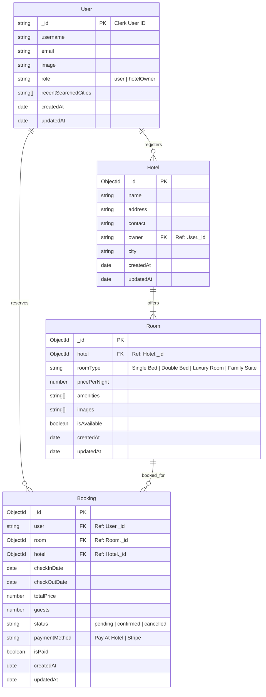

# QuickStay — Full-Stack Hotel Booking & Management Platform

[](https://nodejs.org/)
[](https://expressjs.com/)
[](https://react.dev/)
[](https://tailwindcss.com/)
[](https://www.mongodb.com/)
[](LICENSE)

A production-ready, full-stack web application for hotel reservations and property inventory management. QuickStay provides a luxury booking experience for guests and an administrative suite for hotel owners to list properties, manage room availability, and track revenue analytics in real time.

---

## Table of Contents

- [Overview](#overview)
- [Key Features](#key-features)
- [System Architecture](#system-architecture)
- [Tech Stack](#tech-stack)
- [Database Schema](#database-schema)
- [API Overview](#api-overview)
- [Folder Structure](#folder-structure)
- [Getting Started](#getting-started)
  - [Prerequisites](#prerequisites)
  - [Installation](#installation)
  - [Environment Configuration](#environment-configuration)
  - [Running the Application](#running-the-application)
- [Application Flow & Workflows](#application-flow--workflows)
- [Security & Engineering Practices](#security--engineering-practices)
- [Future Improvements](#future-improvements)
- [License](#license)
- [Author](#author)

---

## Overview

Finding and managing hotel accommodations requires reliable real-time coordination between guest requests, inventory availability, and payment processing.

**QuickStay** provides:
- **Guests**: Instant search by city, dynamic price and amenity filtering, real-time date overlap conflict resolution, secure Stripe payments, and automated email confirmations.
- **Hotel Owners**: Streamlined hotel onboarding, multi-image room uploads via Cloudinary, instant operational availability toggles, and revenue dashboards.

---

## Key Features

### For Guests
- **Interactive Destination Search**: Search hotels by city with search history tracking and auto-complete datalists.
- **Advanced Filtering & Sorting**: Filter by room category (Single Bed, Double Bed, Luxury Room, Family Suite), price bracket, and amenities (Free WiFi, Free Breakfast, Room Service, Mountain View, Pool Access).
- **Date Availability Engine**: Real-time validation preventing double-booking by calculating overlap across active reservations.
- **Multi-Gateway Payment Options**:
  - **Stripe Checkout**: Seamless card processing with automated webhook order status synchronization.
  - **Pay At Hotel**: Offline settlement option with real-time reservation confirmation.
- **Automated Email Confirmations**: HTML booking receipts delivered via Nodemailer with Brevo SMTP relay.
- **User Booking Portal**: Centralized dashboard to review active, upcoming, and past stays, with direct payment completion links for unpaid bookings.

### For Hotel Owners
- **Hotel Onboarding**: Register property details and instantly upgrade user permissions to host role (`hotelOwner`).
- **Room Inventory Control**: Add new rooms with multi-image Cloudinary uploads, pricing, and amenity tags.
- **Availability Toggle**: Immediate operational switch to show or hide individual rooms from public listings.
- **Business Analytics Dashboard**: Summary cards for Total Bookings, Gross Revenue, and comprehensive guest transaction tables.

---

## System Architecture



For an in-depth architectural breakdown, see [docs/architecture.md](docs/architecture.md).

---

## Tech Stack

| Domain | Technologies |
|---|---|
| **Frontend** | React 19, Vite 6, Tailwind CSS v4, React Router DOM v7, React Hot Toast |
| **Backend** | Node.js (ES Modules), Express 5 |
| **Authentication** | Clerk Authentication (`@clerk/clerk-react`, `@clerk/express`, `svix`) |
| **Database** | MongoDB Atlas, Mongoose ODM |
| **Payment Processing** | Stripe API & Stripe Webhooks |
| **Media Storage** | Cloudinary CDN, Multer |
| **Email Service** | Nodemailer, Brevo SMTP Relay |

---

## Database Schema



For full schema details, see [docs/database-design.md](docs/database-design.md).

---

## API Overview

| Method | Endpoint | Access | Description |
|---|---|---|---|
| `GET` | `/api/user/` | Authenticated | Fetch current user role and recent searched cities |
| `POST` | `/api/user/store-recent-search` | Authenticated | Persist recently searched destination (max 3) |
| `POST` | `/api/hotels/` | Authenticated | Onboard new hotel and upgrade user to `hotelOwner` |
| `GET` | `/api/rooms/` | Public | List all active available rooms (sorted by date) |
| `GET` | `/api/rooms/owner` | Authenticated (Owner) | List all rooms belonging to host's hotel |
| `POST` | `/api/rooms/` | Authenticated (Owner) | Create room listing with multi-image Cloudinary upload |
| `POST` | `/api/rooms/toggle-availability`| Authenticated (Owner) | Toggle room listing status |
| `POST` | `/api/bookings/check-availability` | Public | Check room date collision |
| `POST` | `/api/bookings/book` | Authenticated | Reserve room, compute pricing, and send email |
| `GET` | `/api/bookings/user` | Authenticated | Fetch all reservations made by current user |
| `GET` | `/api/bookings/hotel` | Authenticated (Owner) | Fetch host dashboard metrics and reservations |
| `POST` | `/api/bookings/stripe-payment` | Authenticated | Create Stripe checkout session |
| `POST` | `/api/clerk` | Svix Webhook | Sync Clerk user creation/update/deletion with DB |
| `POST` | `/api/stripe` | Stripe Webhook | Mark booking paid on successful payment intent |

For complete request and response schemas, see [docs/api-documentation.md](docs/api-documentation.md).

---

## Folder Structure

```text
QuickStay-FullStack/
├── .gitignore               # Root git exclusions (secrets, builds, node_modules)
├── LICENSE                  # MIT License
├── README.md                # Project documentation
├── docs/                    # Technical architecture & API documentation
│   ├── api-documentation.md
│   ├── architecture.md
│   └── database-design.md
├── client/                  # Frontend single-page application
│   ├── .env.example         # Client environment template
│   ├── .gitignore
│   ├── index.html
│   ├── package.json
│   ├── vite.config.js
│   ├── vercel.json
│   └── src/
│       ├── assets/          # Icons, images, and mock fallback data
│       ├── components/      # UI components (Navbar, Hero, HotelCard, etc.)
│       │   └── hotelOwner/  # Host portal UI components (Sidebar, Navbar)
│       ├── context/         # React Context API (global state & auth tokens)
│       └── pages/           # Client routes (Home, AllRooms, RoomDetails, MyBookings)
│           └── hotelOwner/  # Host pages (Dashboard, AddRoom, ListRoom)
└── server/                  # Backend REST API
    ├── .env.example         # Server environment template
    ├── .gitignore
    ├── package.json
    ├── server.js            # Express app entry point & route definitions
    ├── vercel.json
    ├── configs/             # DB, Cloudinary, and Nodemailer setup
    ├── controllers/         # Request handling & business logic
    ├── middleware/          # Authentication & Multer upload middleware
    ├── models/              # Mongoose data schemas
    └── routes/              # Express route routers
```

---

## Getting Started

### Prerequisites
- [Node.js](https://nodejs.org/) (v18.x or later)
- [MongoDB Atlas](https://www.mongodb.com/cloud/atlas) account
- [Clerk](https://clerk.com/) account
- [Cloudinary](https://cloudinary.com/) account
- [Stripe](https://stripe.com/) account (Test mode)
- [Brevo](https://www.brevo.com/) account (for SMTP relay)

### Installation

1. **Clone the repository**:
   ```bash
   git clone https://github.com/sailohith-45/quickstay.git
   cd quickstay
   ```

2. **Set up Backend**:
   ```bash
   cd server
   npm install
   cp .env.example .env
   ```
   *Edit `.env` with your MongoDB connection string, Clerk API keys, Cloudinary credentials, Stripe keys, and SMTP credentials.*

3. **Set up Frontend**:
   ```bash
   cd ../client
   npm install
   cp .env.example .env
   ```
   *Edit `.env` with your Clerk Publishable Key and backend URL.*

### Running the Application

1. **Start the backend server**:
   ```bash
   cd server
   npm run server
   ```
   The API will run on `http://localhost:3000`.

2. **Start the frontend application**:
   ```bash
   cd ../client
   npm run dev
   ```
   The client will run on `http://localhost:5173`.

---

## Environment Configuration

### Server (`server/.env`)
```env
PORT=3000
MONGODB_URI=mongodb+srv://<username>:<password>@cluster0.mongodb.net

# Cloudinary
CLOUDINARY_CLOUD_NAME=your_cloudinary_cloud_name
CLOUDINARY_API_KEY=your_cloudinary_api_key
CLOUDINARY_API_SECRET=your_cloudinary_api_secret

# Clerk Authentication
CLERK_PUBLISHABLE_KEY=pk_test_...
CLERK_SECRET_KEY=sk_test_...
CLERK_WEBHOOK_SECRET=whsec_...

# Stripe Payment Gateway
STRIPE_PUBLISHABLE_KEY=pk_test_...
STRIPE_SECRET_KEY=sk_test_...
STRIPE_WEBHOOK_SECRET=whsec_...

# SMTP Email Relay
SENDER_EMAIL=your_email@domain.com
SMTP_USER=your_brevo_login
SMTP_PASS=your_brevo_password
CURRENCY=$
```

### Client (`client/.env`)
```env
VITE_BACKEND_URL=http://localhost:3000
VITE_CLERK_PUBLISHABLE_KEY=pk_test_...
VITE_CURRENCY=$
```

---

## Security & Engineering Practices

- **Zero-Secret Commits**: All `.env` files are excluded through rigorous `.gitignore` configurations. Template files (`.env.example`) contain only placeholders.
- **Decoupled Identity Management**: User passwords and session management are delegated to Clerk, eliminating local credential attack surfaces.
- **Webhook Signature Verification**: Both Clerk (via Svix) and Stripe webhooks verify payload signatures against secrets to prevent replay and spoofing attacks.
- **Side-Effect Fault Isolation**: Asynchronous side effects (such as transactional emails) are safely wrapped so SMTP outages do not fail completed database transactions.
- **Normalized Schema Integrity**: Strict relationship references across User, Hotel, Room, and Booking documents.

---

## Future Improvements

- [ ] Add guest review ratings and photo submission.
- [ ] Implement server-side pagination and geo-proximity search.
- [ ] Implement Redis caching for frequently visited hotel catalog queries.
- [ ] Add PDF invoice generation for completed stays.

---

## License

This project is open-source and available under the [MIT License](LICENSE).

---

## Author

**Sai Lohith**
- GitHub: [@sailohith-45](https://github.com/sailohith-45)
- LinkedIn: [Sai Lohith](https://www.linkedin.com/in/sai-lohith-kakani-7283962b9/)
