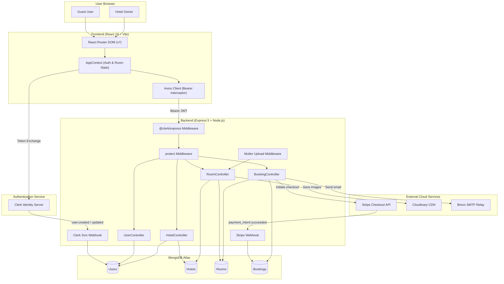
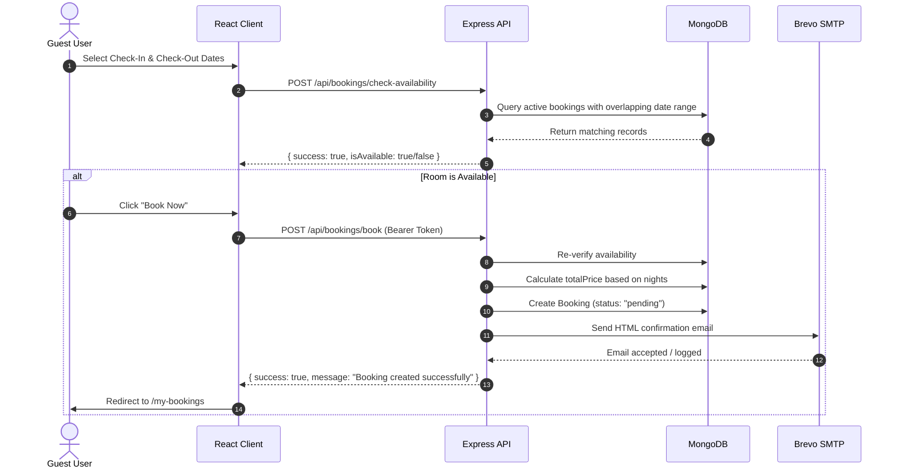

# QuickStay Architecture Documentation

This document describes the high-level architecture, module decomposition, request lifecycles, and security design of **QuickStay**.

---

## 1. High-Level Architectural Pattern

QuickStay is architected as a decoupled client-server web application with external cloud integrations:

- **Client Tier**: Single-Page Application (SPA) built using React 19, Vite, and Tailwind CSS v4.
- **API Tier**: Express 5 application running on Node.js using ES Modules, responsible for business logic, data validation, and third-party orchestration.
- **Data Tier**: MongoDB Atlas managed document store using Mongoose ODM for schema validation and indexing.
- **Third-Party Integrations**:
  - **Clerk**: External Identity Provider (IDP) managing user sessions, JWT issuance, and user synchronization via webhooks.
  - **Stripe**: Hosted Checkout sessions and asynchronous webhook event handling.
  - **Cloudinary**: Object storage and CDN delivery for uploaded hotel room imagery.
  - **Brevo (Nodemailer)**: SMTP relay delivering transactional reservation receipts.

---

## 2. Component & Data Flow

---

## 3. End-to-End Workflows

### 3.1 Authentication & User Synchronization

1. The user signs in or signs up on the frontend using Clerk's managed modal (`useClerk().openSignIn()`).
2. Clerk handles identity verification and returns a session token.
3. Clerk dispatches an asynchronous webhook (`user.created` / `user.updated`) to `/api/clerk`.
4. The backend verifies the Svix signature headers (`svix-id`, `svix-timestamp`, `svix-signature`) using `CLERK_WEBHOOK_SECRET`.
5. The verified user record is saved or updated in the `User` MongoDB collection.
6. When the frontend communicates with the backend, `await getToken()` attaches the Bearer token to requests.
7. The `protect` middleware decodes `req.auth.userId` and fetches the user document from MongoDB.

### 3.2 Hotel Onboarding & Role Transition

1. An authenticated guest clicks **"List Your Hotel"** in the navigation bar.
2. The user fills out hotel name, phone, address, and city.
3. The frontend submits a `POST` request to `/api/hotels/` with their Bearer token.
4. The controller creates a new `Hotel` document with `owner: req.user._id`.
5. The controller immediately updates the user's role in the database to `"hotelOwner"`.
6. The frontend receives `{ success: true }` and sets `isOwner = true`, unlocking the host navigation and sidebar.

### 3.3 Room Creation & Media Pipeline

1. The hotel owner navigates to `/owner/add-room`.
2. The owner enters room type, pricing per night, selects amenities, and selects up to 4 images.
3. The form sends a multipart/form-data request to `POST /api/rooms/`.
4. `multer` buffers the files to temporary disk storage.
5. `roomController` maps through `req.files` and uploads each asset to Cloudinary concurrently via `Promise.all`.
6. The resulting Cloudinary secure URLs are stored in the `images` array of the new `Room` document.
7. The room is linked to the owner's hotel via `hotel: hotel._id`.

### 3.4 Availability Check & Booking Flow

### 3.5 Payment Lifecycle (Stripe Checkout)

1. A user views an unpaid booking on `/my-bookings` and clicks **"Pay Now"**.
2. The frontend sends `POST /api/bookings/stripe-payment` with `{ bookingId }`.
3. The backend calculates the total amount and creates a hosted Stripe Checkout Session containing `metadata: { bookingId }`.
4. The backend returns the Stripe checkout URL, and the client redirects the user to Stripe.
5. Upon successful card charge, Stripe dispatches a `payment_intent.succeeded` webhook to `/api/stripe`.
6. The backend verifies the `stripe-signature` header using `STRIPE_WEBHOOK_SECRET`.
7. The webhook handler retrieves the `bookingId` from metadata and updates the database: `{ isPaid: true, paymentMethod: "Stripe" }`.
8. The user is redirected back to the app via `success_url` (`/loader/my-bookings`).
