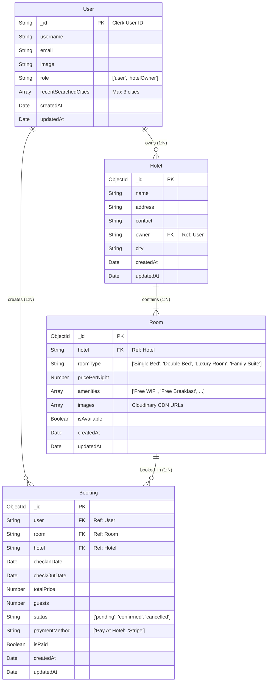

# QuickStay Database Design

QuickStay uses **MongoDB** with **Mongoose ODM**. This document outlines the schema architecture, relationships, constraints, and query patterns.

---

## 1. Entity-Relationship Overview



---

## 2. Collection Schemas & Data Types

### 2.1 Users Collection (`User.js`)
- Primary key `_id` is defined as a `String` matching Clerk's alphanumeric user identifier (e.g., `user_2unqyL4diJFP1...`).
- Tracks user role (`"user"` or `"hotelOwner"`).
- `recentSearchedCities` stores up to 3 FIFO strings representing the user's latest search destinations.

### 2.2 Hotels Collection (`Hotel.js`)
- Represents hotel properties registered on QuickStay.
- `owner` field stores a reference to `User._id`.
- Contains property location details: `name`, `address`, `contact`, and `city`.

### 2.3 Rooms Collection (`Room.js`)
- Represents distinct room units belonging to a hotel.
- Linked to `Hotel` via `hotel` reference.
- `images`: Array of secure HTTPS URLs hosted on Cloudinary.
- `amenities`: Array of strings matched with UI facility icons (e.g. `"Free WiFi"`, `"Room Service"`, `"Pool Access"`).
- `isAvailable`: Operational toggle enabling host to temporarily delist rooms.

### 2.4 Bookings Collection (`Booking.js`)
- Records reservations made by guests.
- Stores denormalized `hotel` alongside `room` to allow fast dashboard aggregations for hotel owners without nested populated lookups.
- `status`: Enum (`"pending"`, `"confirmed"`, `"cancelled"`).
- `isPaid`: Boolean flag updated via Stripe webhook or front-desk check-in.

---

## 3. Query Optimization & Indexing Strategies

### 3.1 Date Collision Query
When a guest searches or attempts a booking, the availability engine executes:
```javascript
Booking.find({
  room,
  status: { $ne: "cancelled" },
  checkInDate: { $lte: checkOutDate },
  checkOutDate: { $gte: checkInDate }
});
```
**Recommended Compound Index**:
```javascript
bookingSchema.index({ room: 1, status: 1, checkInDate: 1, checkOutDate: 1 });
```

### 3.2 Hotel Owner Dashboard Aggregation
To compute total bookings and gross revenue:
```javascript
Booking.find({ hotel: hotel._id }).sort({ createdAt: -1 });
```
**Recommended Index**:
```javascript
bookingSchema.index({ hotel: 1, createdAt: -1 });
```
